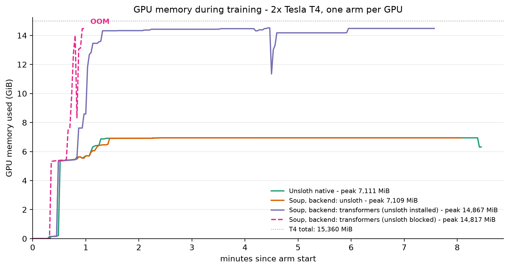

# Soup vs Unsloth: a controlled head-to-head on 2x Tesla T4

[](LICENSE)

Is [Soup](https://github.com/MakazhanAlpamys/Soup) a real alternative to
[Unsloth](https://github.com/unslothai/unsloth), or a nicer wrapper around it?

Four arms, one model (`NousResearch/Meta-Llama-3.1-8B-Instruct`, NF4 QLoRA), identical
data (`yahma/alpaca-cleaned`, 400 rows), identical hyper-parameters, identical step count,
one arm per GPU. Full write-up: [**REPORT.md**](REPORT.md).

This benchmark is the evidence base for the
[**finetune-llm**](https://github.com/instax-dutta/finetune-llm) agent skill - a
hardware-aware, verification-gated fine-tuning workflow for coding agents, built from the
engine budgets and failure modes measured here.

## Headline results

| Arm | Result | Peak VRAM | Final loss | Held-out loss |
|---|---|---|---|---|
| `unsloth_native` | completed | 7,111 MiB | 0.8290 | 1.0373 |
| `soup` `backend: unsloth` | completed | 7,109 MiB | 0.8044 | - |
| `soup` `backend: transformers` | completed | 14,867 MiB | 0.8058 | 1.0405 |
| `soup` `backend: transformers`, unsloth import blocked | OOM | 14,817 MiB | - | - |



- **Quality: a tie.** Held-out loss 1.0373 vs 1.0405, computed by one neutral evaluator that
  imports neither framework. Identical parameter counts, all adapter tensors non-zero,
  Frobenius norms within 0.1%.
- **Compute cost: Unsloth halves VRAM (2.09x).** Soup with `backend: unsloth` peaks 2 MiB
  away from Unsloth native. Soup's speed and memory are Unsloth's engine.
- **Ergonomics: Soup wins, clearly.** One YAML file and zero code, versus a custom training
  script for Unsloth.

## Findings worth knowing

1. **`backend: transformers` is silently unsloth-backed** on any machine where Unsloth is
   installed. Soup calls `is_unsloth_available()` even for the transformers backend, and
   importing Unsloth patches the entire HF/TRL stack. The genuinely-stock arm in this
   benchmark only exists because `scripts/no_unsloth/` blocks the import.
2. **`train_on_responses_only: true` silently did nothing.** The chat template lacks
   `` markers, and Soup reports that as a warning, not an error - the run
   proceeds training on prompt tokens.

Also documented in [REPORT.md](REPORT.md): the `soup-cli[train,fast]` install conflict
(unsloth and transformers versions that resolve but cannot import), `warmup_ratio` removal
in transformers 5.x, Soup's lack of `max_steps`, and the absence of custom kernels in
Soup's speed path.

## Repository layout

```
configs/     Soup YAMLs: unsloth backend, transformers backend, and the config matrix
scripts/     data prep, arm launchers, GPU sampler, neutral evaluator, figure renderer
results/     raw artifacts: logs, GPU samples, trainer states, environment - see results/README.md
REPORT.md    the full write-up, verdict, limitations, and reproduction notes
```

## Reproducing

Requires 2x T4 (or comparable 15 GB cards), `soup-cli` 0.75.0 and Unsloth 2026.9.14 -
environment pins and the known install conflict are recorded in
[`results/environment/`](results/environment) and [REPORT.md](REPORT.md).

```bash
# data (identical bytes for every arm, seed 3407)
python scripts/prep_data.py      # 4000 train / 200 val from yahma/alpaca-cleaned
python scripts/prep_pc.py        # chat-template render + token ids
python scripts/prep_shared.py    # chatml.jsonl (Soup) + text.jsonl (Unsloth)
python scripts/cap_rows.py       # 400 rows => 50 steps at bs1 x accum8

# all four arms, one per GPU
bash scripts/run_matrix.sh

# full-matrix figure from the GPU samples
python scripts/make_figure.py
```

The neutral held-out evaluator ([`scripts/eval_adapter.py`](scripts/eval_adapter.py)) loads
the saved adapters through plain HF/peft with neither trainer in the process.

## Provenance and limitations

- Hardware: 2x Tesla T4 (sm_75, 15,360 MiB each), 31 GB RAM, 4 vCPU.
- Model revision `d10aef79`; dataset `yahma/alpaca-cleaned`; seed 3407.
- Soup measured at commit [`b9ad2fb`](https://github.com/MakazhanAlpamys/Soup/commit/b9ad2fb)
  (soup-cli 0.75.0), Unsloth 2026.9.14. The upstream Soup clone is not vendored into this repo.
- One seed, 50 steps, T4-only. Enough to separate a 2x memory difference from noise; not
  enough to rank a 0.3% quality difference. Do not transfer these numbers to A100/H100.
- Per-step timing was only cleanly measurable for the Unsloth arm; recorded as a gap rather
  than guessed - see [REPORT.md](REPORT.md).

## Credits

Soup by [@MakazhanAlpamys](https://github.com/MakazhanAlpamys) · Unsloth by the
[Unsloth team](https://github.com/unslothai/unsloth) · evaluation dataset
[`yahma/alpaca-cleaned`](https://huggingface.co/datasets/yahma/alpaca-cleaned).

MIT - see [LICENSE](LICENSE).
